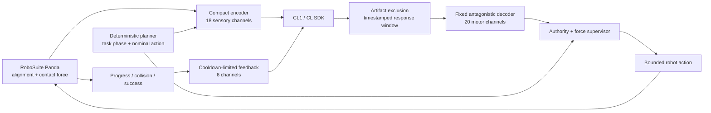

# Senxe Cerebellum — Bounded CL1 Contact-Skill Control

[](https://github.com/AzurLiu/Senxe-Cerebellum/actions/workflows/test.yml)


Senxe Cerebellum is an open experimental architecture for testing whether
living neural activity from a Cortical Labs CL1 can learn a small, bounded
contact-correction skill inside an otherwise deterministic robotic manipulation
system.

The biological component does **not** plan or control the whole robot. It may
only suggest five transparent outputs:

```text
[delta_x, delta_y, delta_z, soften, retract_request]
```

Planning, grasping, rotation, gripper intent, joint control, success
verification and hard force safety remain deterministic.

## Current status

| Area | Status |
|---|---|
| Primary task | RoboSuite `NutAssemblySquare` with Panda |
| Biological authority | Bounded five-output contact skill |
| Channel allocation | Fixed 18 sensory / 20 motor / 6 feedback / 15 reserve |
| Safety | Fail-closed stimulation and cumulative-dose enforcement |
| Evidence | Software, simulator and main-loop integration tests |
| Automated tests | run in GitHub Actions on every push (`pytest tests/`) |
| CL SDK compatibility | 0.1.x and 1.x simulator metadata |
| Real CL1 learning | Not yet tested |
| Physical robot driver | Not implemented |

> [!IMPORTANT]
> Simulator results validate software plumbing, causal controls and safety
> behavior. They are not evidence that a biological culture has learned, and
> this repository must not be represented as physical-robot-ready.

## Research question

Can a CL1 culture improve and retain a low-dimensional contact skill when:

- task phase and nominal motion are supplied externally;
- sensory stimulation and motor readout use a fixed channel map;
- neural authority is independently bounded on X, Y and Z;
- causal controls can remove spikes, shuffle spikes or remove feedback;
- evaluation is frozen and separated from feedback training;
- stimulation dose and every control decision are recorded?

The intended claim is deliberately narrower than end-to-end robot control.

## Architecture



### Authority boundary

| Function | Owner |
|---|---|
| task phase, approach, grasp and transport | deterministic controller |
| rotation and gripper intent | deterministic controller |
| joint commands and action clipping | deterministic controller |
| hard force stop and fallback | deterministic safety supervisor |
| small XYZ contact correction | bounded CL1 readout |
| safe movement softening | bounded CL1 readout |
| retract request | CL1 selects a deterministic retreat primitive |

Low-confidence or empty neural responses fall back to nominal control.
`soften` cannot increase movement authority. A retract request cannot generate
an arbitrary escape vector.

## Hardware-valid channel map

The confirmatory path uses pairwise-disjoint channel regions:

| Role | Count | Purpose |
|---|---:|---|
| sensory | 18 | signed XYZ alignment/force, phase and contact |
| motor | 20 | five antagonistic outputs |
| structured feedback | 6 | progress, collision and success |
| reserve | 15 | preregistered failed-channel replacement |

CL1 channels `0`, `4`, `7`, `56` and `63` are never stimulated. The exact
mapping and SHA-256 hash are stored with every evidence run.

## Safety and evidence

Before every SDK stimulation call, the proxy verifies:

- stimulatable channel membership;
- amplitude and phase width;
- burst frequency and count;
- charge balance;
- cumulative stimulation calls;
- cumulative channel pulses;
- cumulative absolute charge.

Simulator mode is never inferred from SDK internals. It requires
`SENXE_SIMULATOR=1`, and is refused if the installed CL SDK does not look like
the replay simulator. Without it, every run is treated as real CL1 hardware,
and a run is refused if the installed SDK looks like the replay simulator, so
replayed recordings cannot be written to disk as hardware evidence. Every
evidence row, session recording and feedback schedule carries a `Backend`
label (`simulator` or `hardware`); the analysis script only lets
hardware-only tables satisfy a confirmatory or falsification gate.

`core.neurons.cl_open()` is the only entry point to the device. It runs the
approval gate before opening and yields the audited proxy, which refuses
every SDK stimulation method other than the audited `stim()` call.
Real-hardware stimulation is blocked until the operator supplies explicit
approved limits. A stimulation whose device timestamp cannot be read stops a
real-hardware run, because the artifact-exclusion interval of the following
response window could not be verified.

Calibration probes each stimulatable electrode five times and compares the
evoked response with repeated baseline windows. The health gate works on
standardized responses (difference divided by its standard error). Real
hardware has no default threshold: the supervising laboratory must freeze
`SENXE_MIN_INPUT_RESPONSE_Z` and `SENXE_MIN_OUTPUT_RESPONSE_Z` before the run.
A failed fixed mapping stops the task unless a pre-authorized deterministic
reserve remap is enabled.

The wrist force used by the force supervisor is the contact force in the
world frame: the raw sensor reading is rotated out of the sensor frame and
the weight of the gripper is removed, so free space reads zero and the
deterministic retract moves away from the contact.

Because partial runs stay on disk, the analysis script checks every run
(`RunID`) against the frozen protocol before any gate is computed: one row
per protocol episode, in the right phase and scenario split, with the
protocol's hash, and exactly one run per culture and condition, so two
interrupted runs cannot be spliced into a complete one. Only a protocol
marked `"confirmatory": true` in `config/cl1_protocols.json` (currently
`senxe_contact_skill_v2`) can set a confirmatory or falsification flag; the
22-episode application protocol is reported descriptively only. A run the
ledger shows was already started is treated as interrupted and is not
restarted unless `--restart-interrupted-run` is passed, which is itself
recorded. Any incomplete run is listed in `analysis/incomplete_runs.csv` and
blocks every confirmatory and falsification gate. Output conflicts that are
knowable in advance (duplicate run keys, an existing donor schedule) are
rejected before the device is opened, so a mistaken re-run never
re-stimulates a culture.

Each episode is reset with `reset_with_seed`, which reseeds RoboSuite's own
placement generator, so the same seed gives the same initial layout in every
condition; the seed and the initial nut pose are written to each evidence
row.

The benchmark writes each episode row to disk as soon as the episode ends,
and records a run in `<output>.runs.jsonl` before the first pulse, so a
culture that was stimulated in a crashed run cannot be reused under another
condition.

Each evidence record links:

- raw CL recording and timestamped spikes;
- stimulation events and delivered dose;
- nominal and final robot actions;
- force, task phase and feedback events;
- protocol, code and channel-map hashes.

## Causal evaluation

The benchmark supports:

- `contact_skill`;
- `baseline_only`;
- `zero_spikes`;
- `shuffled_spikes`;
- `no_feedback`;
- `yoked_feedback`.

The confirmatory design requires independent cultures, frozen evaluation,
held-out simulator physics, delayed retention and preregistered exclusion
rules. A learning claim must survive these controls; aggregate reward or a
demonstration video is not sufficient.

## Quick start

```bash
git clone https://github.com/AzurLiu/Senxe-Cerebellum.git
cd Senxe-Cerebellum
python -m pip install -e .
pytest -q
```

Run the audited 22-episode simulator/application path:

```bash
export SENXE_SIMULATOR=1
export SENXE_CONTROL_MODE=contact_skill
export SENXE_GENERALIZATION=1
export SENXE_SPIKE_PIPELINE=timestamped
python senxe_demo_robosuite.py
```

Run the simulator-only causal benchmark:

```bash
export SENXE_SIMULATOR=1
python run_ablation_benchmark.py
python analyze_ablations.py ablation_results.csv
python plot_ablations.py
```

Real CL1 use additionally requires operator-approved electrical and cumulative
dose limits. Candidate values in this repository are engineering defaults, not
universal biological safety approval.

## Primary files

| Path | Role |
|---|---|
| `senxe_demo_robosuite.py` | audited application entry point |
| `run_ablation_benchmark.py` | causal and confirmatory benchmark |
| `core/contact_skill.py` | compact encoder and feedback policy |
| `core/channel_map.py` | fixed hardware-valid channel allocation |
| `core/channel_health.py` | calibration health and reserve remap |
| `core/neurons.py` | CL SDK adapter and stimulation safety proxy |
| `core/spike_pipeline.py` | timestamped artifact/response windows |
| `core/provenance.py` | protocol and implementation hashes |
| `config/cl1_protocols.json` | frozen application and study phases |

## Protocols

- [Application protocol](docs/CL1_APPLICATION_PROTOCOL.md)
- [Contact-skill capability boundary](docs/CONTACT_SKILL_V1.md)
- [Confirmatory protocol V2](docs/CL1_PROTOCOL_V2.md)
- [Preregistration V2](docs/PREREGISTRATION_V2.md)
- [Archived experiments](legacy/README.md)

## Scope

This public repository contains the reproducible application architecture.
Private access-request materials and unpublished long-horizon architecture are
intentionally excluded.

## Author and license

Developed by Azur (Jiahao), independent researcher. Licensed under the
[MIT License](LICENSE).
